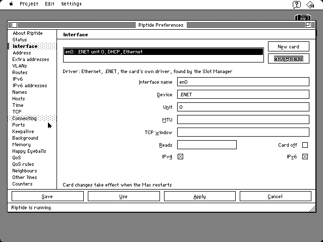
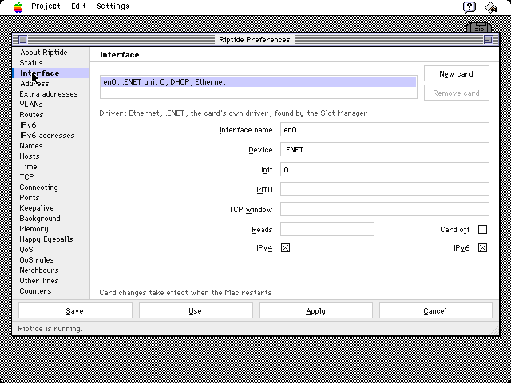
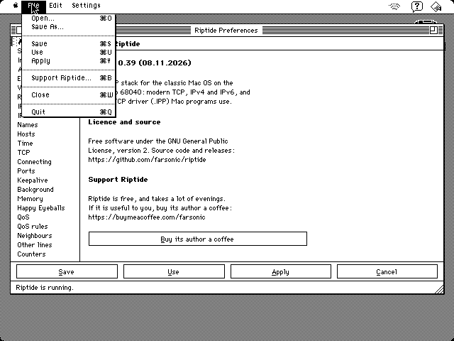
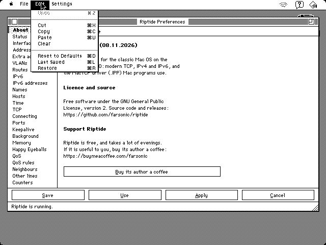
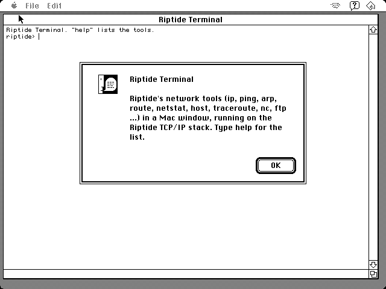
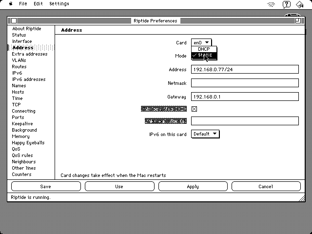

# RiptidePrefs on the Mac: one editor for two platforms

RiptidePrefs, the preferences editor for riptide.conf, exists once. The MUI editor in
`src/amiga/prefs` is compiled for the classic Mac OS as well: the same pages, settings, layout,
help bubbles, list forms, Status and Counters pages, the same reading, checking and writing of
riptide.conf. A new setting, page or wording change made for the Amiga reaches the Mac with the
next `make -f Makefile.mac`, and nothing in the Amiga build changes for the Mac: the Amiga
binary is byte-identical with and without the Mac work (checked with `sha256sum` on
`build/amiga-gcc/RiptidePrefs`).



On a 256-colour screen (the theme's colours, as on the Amiga):



## How it is put together

```
 src/amiga/prefs (unchanged)                      the Mac's side (src/mac)
 ---------------------------                      ------------------------
 mui_main.c   the window, pages, commands         mui/   the part of MUI 3.8 the editor uses,
 mui_classes.c, mui_status.c, mui_counters.c             on the Toolbox (mm_*.c)
              Riptide's own MUI classes           prefs/rp_main_mac.c    main (riptideprefs.c's job)
 mui_theme.c  colours, fonts, icons               prefs/mac_lang.c       tr(): the Mac's words
 mui_util.c, mui_thunks.S  BOOPSI glue            prefs/driver_mac.c     the driver line (.ENET)
 prefs_fields.c, conf_edit.c  settings, riptide.conf                     (driver_amiga.c's job)
 prefs_io.c   load, save, apply                   prefs/rtport_mac.c     the RIPTIDE port, carried
 prefs_status.c, prefs_counters.c, status_amiga.c                        to the .IPP driver
 prefs_driver.c                                   app/   crt0, the Toolbox glue, the packager
```

The editor's files are compiled with `-I` paths that give them the Amiga's own type headers
(`src/amiga/os`) and, in place of the jump-table calls the Amiga build generates, plain
prototypes (`tools/gen_lvos.py CC=proto`, from the same LVO tables). `src/mac/mui` implements
what those prototypes name:

| Amiga | Mac |
|---|---|
| BOOPSI classes, `DoMethodA`, `DoSuperMethodA` (mui_util.c, mui_thunks.S: dispatchers called with the class in a0, object in a2, message in a1) | the same calls, unchanged; the built-in classes use the same register thunks (mm_thunks.S) |
| MUI: Application, Window, Group (rows, columns, pages, weights), Area, Rectangle, String, Cycle, Image (check mark), List, Listview, menu strips from NewMenu, notifications, event handlers, input handlers (timers), MUI_Redraw | mm_boopsi.c, mm_app.c, mm_area.c, mm_group.c, mm_gadgets.c: a window per MUI window, TextEdit for strings, pop-up menus for cycles, the menu bar from the NewMenu table (Apple menu and the Mac's Edit items added), help bubbles after a second's rest |
| graphics.library (SetAPen, RectFill, Text, TextLength, ObtainBestPenA, ScrollRaster ...) | mm_gfx.c on QuickDraw: pens are RGB. Each window is drawn for the screen it is on (the deepest screen it touches, asked again when it opens, moves, changes size or is redrawn): colour screens of 2 bits and more get RGBForeColor in colour windows (NewCWindow), one-bit screens dither the theme's greys and dim disabled text. A window dragged from the SE's screen to a colour screen changes over |
| exec ports and lists, dos files (Lock, Open, Read, Write, Rename ...), ASL | mm_os.c: the File Manager by path, Standard File for Open and Save As |
| ENVARC:Riptide/ and ENV:Riptide/ | the Riptide folder in the Preferences folder, and its folder "In Use" (emptied by Riptide when the Mac starts, as ENV: goes with a reboot) |
| the RIPTIDE message port (COMMAND, TABLES, STATUS) | rtport_mac.c: FindPort("RIPTIDE") answers when Riptide's .IPP is installed; a message put there becomes a private .IPP Control call (`RTMAC_PORT`, src/mac/ipp.c), run in the stack's context with the core's own `rt_ctl_command` and `rt_sysctl_bymib` |

## The Mac's words and the Mac's card

The editor's texts speak of the Amiga's things: SANA-II drivers, DEVS:, ENV:, uaenet.device,
"the Amiga". Every text the editor shows passes through `tr()`, its translation hook
(mui_lang.c, English only on the Amiga). The Mac build links `src/mac/prefs/mac_lang.c`
instead, whose `tr()` replaces those words: whole help texts where the Mac's answer differs (the
Device field: always `.ENET`; Unit: which Ethernet card; Reads: not used on the Mac), words
elsewhere (SANA-II, uaenet.device, the Amiga). The rules are keyed on distinctive pieces of the
texts, so small changes of the Amiga's wording keep working; a new text that names something
only the Amiga has needs a rule there.

The card of a riptide.conf without one is a compile-time default (`RP_DEFAULT_IFNAME`,
`RP_DEFAULT_DEVICE` in conf_edit.c: eth0 on uaenet.device; Makefile.mac gives en0 on .ENET).
riptide.conf on the Mac uses the Amiga's form of the card line, which the Mac driver now
understands: `interface en0 device=.ENET unit=0 [mtu=] [ipv4=] [ipv6=] [tcpwindow=] [disabled]`.
On the first run, with no riptide.conf yet, the editor writes a starting one (the card and
DHCP), as the Amiga's Installer does.

## Save, Use, Apply and Cancel on the Mac

The buttons do what they do on the Amiga: **Save** writes riptide.conf for good (Preferences
folder) and gives the changes to the running Riptide; **Use** writes the In Use copy (until the
Mac restarts) and gives the changes; **Apply** gives the changes to the running Riptide only and
keeps the window open; **Cancel** forgets them. Riptide for the Mac cannot yet restart its
network while it runs (RTCMD_RESTART), so changes to the card and its addresses take effect
when the Mac restarts, and the editor says so.

## Keeping both versions in step

- A new setting: one line in `rp_fields[]` (prefs_fields.c). Both editors show it.
- A new page or class: in `src/amiga/prefs` as for the Amiga. A new class's dispatcher goes into
  `mui_thunks.S`, which both builds assemble. If it uses a MUI attribute, method or class the
  editor has not used before, it is added to `mui.h` (as for the Amiga) and to `src/mac/mui`.
- A new OS call: `src/mac/mui/mm_os.c` (the link fails until it is there).
- A text that names an Amiga thing: a rule in `src/mac/prefs/mac_lang.c`.
- Check the Amiga build stays the same: `make -f Makefile.amiga TOOLCHAIN=gcc build/amiga-gcc/RiptidePrefs`
  before and after, and compare the binaries.

## Building and trying it

```
make -f Makefile.mac          # build/mac/Riptide.bin (the extension) and build/mac/RiptidePrefs.bin
```

Copy both to an HFS image with `hcopy -m`: Riptide into the Extensions folder (MacTCP out of the
Control Panels folder), RiptidePrefs anywhere (the Control Panels folder or the Apple menu
suit it). The testbed (docs/MAC.md, "Testing on Aurora68") runs it under QEMU; Aurora68's
`mac.inputclick=SECONDS,X,Y,X,Y...` clicks through it for screenshots.

Screens under 560 usable lines (every classic size up to 640 x 480) get the editor's compact
layout, which fits a 640 x 480 screen in 610 x 361.

## The Riptide Terminal

The same idea for the command-line tools: src/amiga/cmd compiled unchanged into one Mac program
with a console window (docs/MAC.md, "The Riptide Terminal"). It reuses this editor's Mac pieces:
src/mac/app (start-up, Toolbox glue) and src/mac/mui/mm_os.c (exec and dos), with the console's
Output(), Input(), Read and Write in src/mac/term. A new tool for the Amiga is one line in the
terminal's table (term_main.c) and one name in Makefile.mac's TERM_TOOLS.

## Human Interface Guidelines

Mac programs follow Apple's *Macintosh Human Interface Guidelines* (Addison-Wesley, 1992). The
Mac MUI layer does what the guidelines ask for every MUI program built on it, so a port gets it
without changes of its own. Page numbers are the book's.

 

**Menus** (ch. 4; `src/mac/mui/mm_app.c`, `menus_install`): the menu bar is made from the program's
NewMenu strip, or for a program without one (Lagoon) from nothing. It is laid out as the Mac has it:

| Menu | What goes there |
|---|---|
| Apple (p. 95) | "About *program*…" first. It is the program's own About command, wherever its strip had it, and is named from `MUIA_Application_Title`. Without one, an alert with the program's name. Then a separator and the desk accessories. |
| File (p. 87) | The program's Project or File menu, renamed File. Close ⌘W (what the front window's close box does) unless the program has a Close. Then a separator and Quit ⌘Q last. The program's Quit goes there, or `MUIV_Application_ReturnID_Quit` if it has none. |
| Edit (p. 101) | Always present: Undo ⌘Z, a separator, Cut ⌘X, Copy ⌘C, Paste ⌘V, Clear. They work on the text field being typed in, and on desk accessories through SystemEdit. A program's own Edit commands follow after a separator. |
| the rest | The program's other menus, in its order. |

Other menu rules:
- **Reserved keys (p. 128, Table 4-1).** ⌘N, O, W, S, P, Q, Z, X, C, V, A and period keep their
  meaning: a program's command keeps such a key only if it is that command. RiptidePrefs' "Save
  As…" loses its ⌘A, which is Select All's.
- **Labels (p. 67-71).** "..." becomes the ellipsis character, MUI's '_' keyboard markers go,
  Exit becomes Quit, and Drawer becomes Folder (`mm_hig.c`).
- **State.** Menu items are enabled, disabled and checked as the program's Menuitem objects say.

**Windows** (ch. 5):
- **Kind (p. 140-145).** A window whose size MUI can change gets a size box and a zoom box. A
  fixed-size one is a plain document window, with neither.
- **Placement (p. 147-149).** Windows open on the main screen, wholly below the menu bar.
  - A window the program centres goes across the screen and a third of the way down, where the
    Mac puts its dialogs.
  - Other windows open from the top left, each new one below and to the right of the last.
- **Close (⌘W).** File's Close does what the close box does: `MUIA_Window_CloseRequest`.

**Alerts and dialogs** (ch. 6; `src/mac/app/mac_alert.c`, `MUI_RequestA` in `mm_os.c`):
- **Layout (p. 192-197).** MUI's requester is the Mac's alert box: the note icon for one
  button and the caution icon for more, the message wrapped in the system font, and the buttons
  at the bottom right.
- **Button order (p. 196).** The order is reversed for the Mac: MUI's first gadget, the
  affirmative one, stands at the right, and its last gadget, the negative one, at the left as
  Cancel. MUI's return values are kept.
- **Default button (p. 205-206).** The default button, the gadget MUI marks '*' or else the
  first, has the heavy rounded outline and answers Return and Enter. Cancel answers Escape and
  ⌘-period, each flashing for eight ticks.
- **Placement.** Alerts sit a third of the way down the main screen, and the program's windows
  behind them are redrawn while they are up.
- **Formatting.** The text is formatted as exec's RawDoFmt formats it (`%d` is a WORD), and MUI's
  escape sequences are dropped.
- **Programs without MUI.** The same alert serves them: the Riptide Terminal's About box is one.



**Controls** (ch. 7):
- **Push buttons (p. 204-205).** Push buttons (`MUIV_Frame_Button`) are rounded rectangles,
  inverted while held, at least 20 pixels high and 59 wide.
- **Pop-up menus (p. 85).** Cycle gadgets are pop-up menus: a box with a one-pixel shadow and the
  triangle, the current choice ticked, the label to the left.
- **Dimmed items.** Disabled controls and labels are dimmed: on a one-bit screen a light grey
  pattern takes a quarter of the ink. Until now a wrong pen mode, notPatXor where patBic was meant,
  had turned them into grey blocks.
- **Password fields.** A `MUIA_String_Secret` string shows a bullet for each character. The text
  stays in the object, is never put in TextEdit, and is never cut or copied.

  

**Behaviour** (ch. 10, p. 286):
- **Pointers.** The I-beam over a text field that can be edited, the arrow elsewhere.
- **The watch.** The watch while a window or the whole program sleeps (`MUIA_Window_Sleep`,
  `MUIA_Application_Sleep`).
- **Tab.** Tab moves between the text fields of the cycle chain, as it did before.

What the layer cannot do for a program:
- **Custom classes.** A program's own classes that draw themselves (RiptidePrefs' `qbutton` and
  `qlabel`) are out of the layer's reach. They keep their look unless the program changes them
  for the Mac. RiptidePrefs does this under `MM_MAC_HIG`: a Mac-only define, set by Makefile.mac
  and never by the Amiga build, so the Amiga binary is the same byte for byte. Its buttons then
  use `mm_hig_button` and its labels show no '_' markers.
- **Escape in program windows.** Escape and ⌘-period in an ordinary MUI window stay with the
  program. The guidelines give them no meaning outside dialogs and alerts, and turning them into
  a close request would quit main windows.

## Porting another MUI program to the Mac

The steps that brought RiptidePrefs and Lagoon (farsonic/lagoon, branch mac-port) over:

1. **Build files.** Compile the program's MUI sources unchanged with `APP_CFLAGS` from
   Makefile.mac. They give the Amiga's types (`src/amiga/os`), plain prototypes in place of the
   library jump tables (`tools/gen_lvos.py CC=proto`) and `-DMM_MAC_HIG`. Link them with
   `src/mac/app` (crt0, ostraps, the Toolbox glue, `mac_alert.o`) and `src/mac/mui`
   (`mm_*.o`, `mm_hig.o`, `mm_thunks.o`). Lagoon's Makefile.mac does this from another
   repository with `RIPTIDE ?= ../riptide`, copying nothing.
2. **Link errors.** Each one is an OS call or MUI class the layer does not have yet. Add it to
   `src/mac/mui` (`mm_os.c` for exec, dos and ASL; the class files for MUI), never to the program.
   Keep every MUI attribute the layer already understands.
3. **Custom classes.** Dispatchers go into the program's thunks (`mui_thunks.S` style:
   register-passing BOOPSI dispatchers). Classes that draw themselves get `#ifdef MM_MAC_HIG`
   where the Mac look differs: `mm_hig_button` for buttons, no '_' underlines.
4. **The program's words.** Provide `tr()`, the translation hook, if the program has one (for
   RiptidePrefs, `src/mac/prefs/mac_lang.c`). Add a rule wherever a text names an Amiga thing:
   SANA-II, DEVS:, ENV:, Workbench, the Amiga. The generic words (Folder, Quit, the ellipsis) are
   done by `mm_hig.c` already.
5. **Titles and settings.**
   - Give the Application object a `MUIA_Application_Title`: the About item uses it.
   - Mark password strings `MUIA_String_Secret`.
   - Mark the default requester gadget with '*'.
6. **Check on the Mac** (the QEMU testbed, docs/MAC.md):
   - the menus: About in the Apple menu, File ending with Close and Quit, the standard Edit;
   - a requester: buttons, icon, Return, Escape;
   - windows: placement, size box only if resizable;
   - pop-ups;
   - disabled controls;
   - the I-beam and the watch.
7. **Check the Amiga.** The program's Amiga binary must not change: `sha256sum` before and after.

## Known gaps

- Riptide for the Mac drives one Ethernet card (unit 0).
- RESTART (applying card and address changes without a restart of the Mac) is not there yet.
- The window is laid out from the editor's sizes; the 512 x 342 screen of a compact Mac is
  narrower than the editor's smallest compact window (530 pixels).
- The guidelines' fonts are only partly followed: menus, alerts and push button names are in the
  system font, but the MUI windows' own text is Geneva 10 (the editor's layouts are measured for
  it), where the guidelines would have Chicago 12 for labels and buttons.
