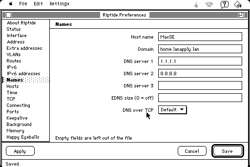
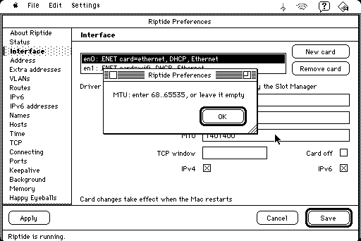
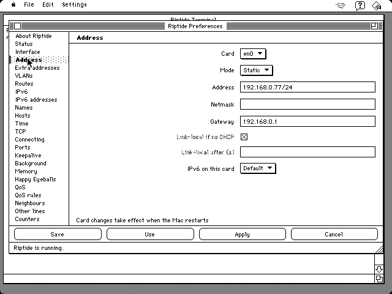
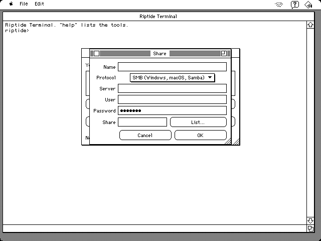

# RiptidePrefs on the Mac: one editor for two platforms

RiptidePrefs, the preferences editor for riptide.conf, exists once. The MUI editor in
`src/amiga/prefs` is compiled for the classic Mac OS as well: the same pages, settings, layout,
help bubbles, list forms, Status and Counters pages, the same reading, checking and writing of
riptide.conf. A new setting, page or wording change made for the Amiga reaches the Mac with the
next `make -f Makefile.mac`, and nothing in the Amiga build changes for the Mac: the Amiga
binary is byte-identical with and without the Mac work (checked with `sha256sum` on
`build/amiga-gcc/RiptidePrefs`).


On a 256-colour screen (the theme's colours, as on the Amiga):


## How it is put together

```
 src/amiga/prefs (unchanged)                      the Mac's side (src/mac)
 ---------------------------                      ------------------------
 mui_main.c   the window, pages, commands         mui/   the part of MUI 3.8 the editor uses,
 mui_classes.c, mui_status.c, mui_counters.c             on the Toolbox (mm_*.c)
              Riptide's own MUI classes           prefs/rp_main_mac.c    main (riptideprefs.c's job)
 mui_theme.c  colours, fonts, icons               prefs/mac_lang.c       tr(): the Mac's words
 mui_util.c, mui_thunks.S  BOOPSI glue            prefs/driver_mac.c     the driver line (.ENET)
 prefs_fields.c, conf_edit.c  settings, riptide.conf                     (driver_amiga.c's job)
 prefs_io.c   load, save, apply                   prefs/rtport_mac.c     the RIPTIDE port, carried
 prefs_status.c, prefs_counters.c, status_amiga.c                        to the .IPP driver
 prefs_driver.c                                   app/   crt0, the Toolbox glue, the packager
```

The editor's files are compiled with `-I` paths that give them the Amiga's own type headers
(`src/amiga/os`) and, in place of the jump-table calls the Amiga build generates, plain
prototypes (`tools/gen_lvos.py CC=proto`, from the same LVO tables). `src/mac/mui` implements
what those prototypes name:

| Amiga | Mac |
|---|---|
| BOOPSI classes, `DoMethodA`, `DoSuperMethodA` (mui_util.c, mui_thunks.S: dispatchers called with the class in a0, object in a2, message in a1) | the same calls, unchanged; the built-in classes use the same register thunks (mm_thunks.S) |
| MUI: Application, Window, Group (rows, columns, pages, weights), Area, Rectangle, String, Cycle, Image (check mark), List, Listview, menu strips from NewMenu, notifications, event handlers, input handlers (timers), MUI_Redraw | mm_boopsi.c, mm_app.c, mm_area.c, mm_group.c, mm_gadgets.c: a window per MUI window, TextEdit for strings, pop-up menus for cycles, the menu bar from the NewMenu table (Apple menu and the Mac's Edit items added), help bubbles after a second's rest |
| graphics.library (SetAPen, RectFill, Text, TextLength, ObtainBestPenA, ScrollRaster ...) | mm_gfx.c on QuickDraw: pens are RGB. Each window is drawn for the screen it is on (the deepest screen it touches, asked again when it opens, moves, changes size or is redrawn): colour screens of 2 bits and more get RGBForeColor in colour windows (NewCWindow), one-bit screens dither the theme's greys and dim disabled text. A window dragged from the SE's screen to a colour screen changes over |
| exec ports and lists, dos files (Lock, Open, Read, Write, Rename ...), ASL | mm_os.c: the File Manager by path, Standard File for Open and Save As |
| ENVARC:Riptide/ and ENV:Riptide/ | the Riptide folder in the Preferences folder, and its folder "In Use" (emptied by Riptide when the Mac starts, as ENV: goes with a reboot) |
| the RIPTIDE message port (COMMAND, TABLES, STATUS) | rtport_mac.c: FindPort("RIPTIDE") answers when Riptide's .IPP is installed; a message put there becomes a private .IPP Control call (`RTMAC_PORT`, src/mac/ipp.c), run in the stack's context with the core's own `rt_ctl_command` and `rt_sysctl_bymib` |

## The Mac's words and the Mac's card

The editor's texts speak of the Amiga's things: SANA-II drivers, DEVS:, ENV:, uaenet.device,
"the Amiga". Every text the editor shows passes through `tr()`, its translation hook
(mui_lang.c, English only on the Amiga). The Mac build links `src/mac/prefs/mac_lang.c`
instead, whose `tr()` replaces those words: whole help texts where the Mac's answer differs (the
Device field: always `.ENET`; Unit: which Ethernet card; Reads: not used on the Mac), words
elsewhere (SANA-II, uaenet.device, the Amiga). The rules are keyed on distinctive pieces of the
texts, so small changes of the Amiga's wording keep working; a new text that names something
only the Amiga has needs a rule there.

The card of a riptide.conf without one is a compile-time default (`RP_DEFAULT_IFNAME`,
`RP_DEFAULT_DEVICE` in conf_edit.c: eth0 on uaenet.device; Makefile.mac gives en0 on .ENET).
riptide.conf on the Mac uses the Amiga's form of the card line, which the Mac driver now
understands: `interface en0 device=.ENET unit=0 [mtu=] [ipv4=] [ipv6=] [tcpwindow=] [disabled]`.
On the first run, with no riptide.conf yet, the editor writes a starting one (the card and
DHCP), as the Amiga's Installer does.

## Save, Apply and Cancel on the Mac



The Mac has three buttons at the bottom of the window, as the Guidelines' dialogs do (p. 196,
205-206): **Apply** at the left, **Cancel** and **Save** at the right, Save the default with the
heavy rounded outline.

- **Save** (Return, Enter, File > Save, Command-S): writes riptide.conf in the Riptide folder of the
  Preferences folder at once (the old one kept as riptide.conf.bak, a copy in its In Use folder),
  then gives the running Riptide every change it can take without a question, and the window stays
  open. The status line says what happened: "Saved; Riptide took 2 changes.", or, when a change
  needs Riptide's network restarted, "Saved; Riptide's network restarted for: the cards and their
  addresses." Those changes: a card, its name, unit, MTU, TCP window or address (DHCP or static),
  IPv4 or IPv6 on or off for all cards, a card turned off or on, settings set back to Default
  (`rp_restart_what`, conf_edit.c). Until 23 November 2026 they waited for the Mac's next start
  ("Saved. Restart the Mac for: ..."); now Save sends RTCMD_RESTART and the running Riptide reads the
  file again ("Restarting the network while the Mac runs" in docs/MAC.md: the cards that stay are
  kept open, connections over an address that remains go on). A Riptide too old to restart answers
  "unknown command", and the editor says "Restart the Mac for: ..." as before. Lines the restarted
  Riptide refused are shown in an alert. After a Save the saved file is the new starting point:
  "Not saved yet" goes from the status line. The old file is kept as riptide.conf.bak: on the
  Mac that never happened before (`Rename` in mm_os.c gave _HRename the new name alone, which the
  File Manager refuses with bdNamErr when the old one is a full path; it now gets the full path).
- **Apply** (File > Apply, Command-Y): the same for the running Riptide only; the saved file is not
  written, so the changes last until the Mac restarts ("Applied 2 changes.  Not saved yet."). It is
  the Amiga's Use and Apply in one: the Mac's Riptide reads only the saved riptide.conf when it
  starts. When a change needs the network restarted, Apply writes the settings to the In Use folder
  (as the Amiga's Use writes ENV:) and the restart reads that copy ("Applied; Riptide's network
  restarted for: ...  Not saved yet.").
- **Cancel** (Escape, Command-period, the close box, Command-W): closes the window. Changes that
  were not saved are forgotten; changes already applied stay in the running Riptide until the Mac
  restarts (Cancel does not take them back: the Guidelines' Cancel undoes the dialog's own edits,
  and Apply was a command of its own).



Every failure is an alert with the reason, and the status line says that nothing was saved:
a setting that is wrong (the alert names it and its page is shown), riptide.conf that cannot be
written (its full Mac path and the File Manager's reason: "the disk is locked", "the disk is
full", "the file is open for writing in another program", with the error number; mm_os.c keeps
the last File Manager error for `IoErr()`), and a change the running Riptide refused (the
command and Riptide's answer).

The keys are the Guidelines' dialog keys, which the Mac MUI layer gives a program that asks for
them (`mm_dialog_keys`, mm_app.c): Return and Enter press the default button even while a text
field is being typed in (the field takes its text first), Escape and Command-period press Cancel.
The default button's outline is drawn by `mm_hig_ring` (mm_area.c) for a `qbutton` whose key is
Return, so RiptidePrefs' own messages ("OK", "Apply|Later") get it too.

**Why saving failed** (fixed 23 November 2026): a riptide.conf that chooses its cards by kind, as
docs/MAC.md shows it (`interface en0 device=.ENET card=ethernet`, `interface en1 device=.ENET
card=wifi`, no `unit=`), has both cards on .ENET unit 0 as far as the editor's model goes, and the
check before saving refused it ("Unit: another card uses this device and unit already"), so neither
Save nor Use wrote anything. On the Mac `card=`, `slot=` and `id=` choose the card and the unit is
not used (net_mac.c `select_card`); the check now leaves such cards alone (`picks_card`,
prefs_fields.c), and the Interface page's list shows "en1: .ENET card=wifi, DHCP" for them. The
Amiga keeps the check: its lines never have `card=`.

**The compact Mac's screen.** The window now fits 512 x 342: 494 x 304 at its smallest (it was
530 pixels wide, the page head's minimum of 36 lines of the font; on a screen under 560 pixels wide
it is 33, which the widest page, Time, still fits). Before, the right edge of the window, where
Save now stands, was off the SE's screen.

**Tested** (23 November 2026) on Aurora68's solo testbed at 512 x 342 (`mac.screen=512x342`, the
512 x 342 declaration ROM, System 7.1, Riptide running with DHCP), driven through the remote
control, with the riptide.conf of docs/MAC.md (`card=ethernet`, `card=wifi`): Domain changed and
Return pressed: "Saved; Riptide took 1 change.", the file in the Preferences folder had the new
line; RiptidePrefs quit and opened again showed it. A change and Escape closed the window and the
next start showed the saved value; Command-period closed it as well. Apply of a domain changed the
running Riptide's name (the Status page: "Host name: MacSE.home.lan...") and not the file. An MTU
change saved with Return: "Saved. Restart the Mac for: the cards and their addresses." and
riptide.conf.bak made. A wrong MTU: the alert above, nothing written.

On the Amiga nothing changes: Save, Use, Apply and Cancel as before (everything above is under
`MM_MAC_HIG`, which only Makefile.mac defines). Shared changes the Amiga gets: the check of card
lines (a line with `card=`, `slot=` or `id=`, which Amiga lines never have), the card list's text
for such lines, and the 33-line head on a screen under 560 pixels wide.

## Every setting and what acts on it on the Mac

Audited 23 November 2026 against mac-port at fed1a6d; the rows of the Names and Happy Eyeballs pages
brought up to date the same day, when the DNR's and .IPP6's lookups moved onto the core resolver and
.IPP6 got its connect by name (EDNS size, DNS over TCP, Happy Eyeballs, DNS negative cache).
Riptide for the Mac reads riptide.conf when it starts (src/mac/main_mac.c `configure`: the core's `rt_config_line` with the Mac's own
`interface`, `mactcp` and `ipp6` lines), and Save and Apply send the changes as commands to the
running stack (`rp_live_commands`, conf_edit.c; RTMAC_PORT in src/mac/ipp.c `port_call`, the
core's `rt_ctl_command`). The core is the Amiga's, so a setting the core acts on works on the Mac
too unless the Mac never reaches that code. The rows marked **works (restart)** were "start" in
the audit; since 23 November 2026 (branch prefs-restart) Save and Apply restart Riptide's network
for them (RTCMD_RESTART, main_mac.c `mac_restart`; docs/MAC.md, "Restarting the network while the
Mac runs").

**works**: acts at start and on Save/Apply. **works (restart)**: acts at start, and on Save/Apply
through a restart of Riptide's network while the Mac runs. **start**: acts only when the Mac
starts (none is left).
**partly**: see the note. **nothing**: no code acts on it on the Mac. **hidden**: the Amiga's
alone; the Mac leaves it out of its page (`FL_AMIGA`, prefs_fields.c; the value stays in
riptide.conf).

| Page | Field or button | riptide.conf | Mac | Evidence | Fix |
|---|---|---|---|---|---|
| Interface | Cards list, Add card, Remove card | `interface NAME device=.ENET ...` | works (restart) | main_mac.c `interface_line`, net_mac.c `net_mac_open` | `mac_restart`: a card removed is closed, one added opened, one kept stays open at its driver |
| Interface | Interface name | `interface NAME` | works (restart) | main_mac.c `interface_line` | a renamed card is closed and opened under its new name |
| Interface | Device | `device=` | hidden | `interface_line` takes only `.ENET` | hidden (FL_AMIGA); new cards get .ENET |
| Interface | Unit | `unit=` | works (restart) | net_mac.c `select_card`: the Nth Ethernet card; `card=`, `slot=`, `id=` come first | two `card=` lines on unit 0 no longer stop Save (`picks_card`) |
| Interface | MTU | `mtu=` | partly | `net_mac_open`, `net_mac_renew`: 576 to 1499, anything else is 1500 | live through the restart (the card kept open) |
| Interface | TCP window | `tcpwindow=` | works (restart) | `interface_line`: `nif->tcp_window` | |
| Interface | Reads | `reads=` | hidden | `interface_line` skips `reads=` | hidden (FL_AMIGA) |
| Interface | Card off | `disabled` | works (restart) | `interface_line` does not open it; "interface NAME delete" is refused while the Mac runs | Save and Apply restart the network instead (`net_mac_close`: the card detached from its driver); on again: opened |
| Interface | IPv4, IPv6 (all cards) | `ipv4 on/off`, `ipv6 on/off` | works (restart) | core config.c | |
| Address | Mode, Address, Netmask, Gateway | `dhcp IF`, `ifconfig IF A netmask M up`, `route add default G` | works (restart) | core config.c, dhcp.c | static to DHCP and back while the Mac runs (docs/MAC.md) |
| Address | Link-local if no DHCP, after (s) | `dhcp IF linklocal off wait S` | works (restart) | core `rt_dhcp_set_linklocal` | |
| Address | IPv6 on this card | `interface ... ipv6=`, `ipv6 IF on/off` | works | `interface_line`, core `ipv6` command | |
| Extra addresses | the list | `ifconfig IF alias A/BITS` | works | core config.c ifconfig | |
| VLANs | the list | `interface IF.ID vlan= parent=` | nothing | core vlan.c makes the interface, but net_mac.c attaches protocol handlers for IPv4, ARP and IPv6 only: no tagged frame ever arrives | page help says so on the Mac (mac_lang.c); bigger gap below |
| Routes | the list | `route add ...` | works | core config.c route | |
| IPv6 | Router advertisements, Temporary addresses, Address identifiers, Duplicate checks, Announce new addresses | `sysctl net.inet6.ip6.*` | works | core ip6 | |
| IPv6 addresses | the list | `ifconfig IF inet6 A/P` | works | core config.c | |
| Names | Host name | `hostname` | works | core; without one, main_mac.c `default_hostname` (Sharing Setup) | |
| Names | Domain | `domain` | works | core resolver's search list (.IPP6 `rt_dns_search_list`) | |
| Names | DNS server 1-3 | `nameserver` | works | the core resolver's servers, for every lookup | |
| Names | EDNS size, DNS over TCP | `sysctl dns.edns_size`, `dns.tcp_fallback` | works (fixed) | the core resolver only: the Riptide Command Terminal (api_mac.c). The DNR (mactcp.c) and .IPP6 (ipp6.c) had DNS clients of their own, without EDNS or TCP | 23 November 2026: the DNR's and .IPP6's lookups are the core resolver's asynchronous ones (`rt_dns_lookup_*`, resolv.c), polled in the stack's deferred task; their DNS clients are gone (docs/MAC.md, "On the core resolver") |
| Hosts | the list | `host NAME ADDR` | works | the core resolver's hosts table (`rt_resolve_local46`, `rt_dns_lookup_start`) | |
| Time | NTP time sync, NTP servers | `ntp ...` | works | core ntp.c; os_mac.c sets the clock (SetDateTime, fed1a6d) | |
| Time | Time zone | `timezone` | works | os_mac.c (`auto`: the Map control panel) | |
| Time | mDNS responder | `mdns on/off` | works | core netsvc; on unless `mdns off` (main_mac.c) | |
| Time | Set Clock Now | (`ntp sync`) | works | mui_main.c `ntp_sync_now`, core ctl.c | |
| TCP | Quick ACK, Delayed ACK segments, Delayed ACK limit, ECN | `sysctl net.inet.tcp.*` | works | core tcp_input.c, tcp_output.c | |
| Connecting | Fast Open, Fast Open backoff | `sysctl net.inet.tcp.fastopen*` | partly | MacTCP has no call that asks for Fast Open, so only "Fast Open defer all" reaches its programs' connections (not tried with them) | |
| Connecting | Fast Open defer all, SYN first RTO, SYN max RTO, SYN backoff, MTU probing | `sysctl net.inet.tcp.*` | works | core tcp | |
| Ports | Connect timeout, ICMP unreachable, Time-wait reuse, Time-wait limit, Local ports from/to | `sysctl net.inet.*` | works | core tcp; MacTCP's local port 0 takes one from the range | |
| Keepalive | Keepalive all, Idle time, Probe interval, Probe count | `sysctl net.inet.tcp.keep*` | works | core tcp_timer; MacTCP has no keepalive call, so "Keepalive all" is the way to turn it on | |
| Background | Default TCP algorithm, Background mode, Remote ports, Local ports, LEDBAT target, LEDBAT slowdowns | `sysctl net.inet.tcp.*` | works | core tcp_ledbat.c | |
| Background | Background programs | `sysctl net.inet.tcp.bg_programs` | works (fixed) | os_mac.c `rt_os_program_name` gave "" | the program that made the stream (CurApName at TCPCreate and UDPCreate, ipp.c `ipp_creator_prog`) is its socket's program (mactcp.c, ipp6.c) |
| Memory | Low water, Pressure, High water | `sysctl net.inet.tcp.mem_*` | works | core tcp_mem.c | |
| Happy Eyeballs | Happy Eyeballs, Attempt delay, Resolution delay, IPv6 lookup filter | `sysctl net.inet.he.*` | works (fixed) | core `rt_he_connect` and the filter served riptide.library's connect by name (src/amiga/riptidelib.c) only; MacTCP and .IPP6 programs connected to addresses | .IPP6's ip6ConnectName (csCode 77, interface version 2; docs/IPP6.md) connects by name with the core's asynchronous Happy Eyeballs (`rt_he_conn_*`, happy.c): all four apply to it, and Resolution delay to the DNR's lookups too. Shown on the Mac again (no FL_AMIGA; the Amiga's RiptidePrefs differs only in those four flag bytes), page help in mac_lang.c |
| Happy Eyeballs | Prefer | `sysctl net.inet.he.prefer` | works (fixed) | nothing read it on the Mac | .IPP6's default answer order and ip6ConnectName's first family follow it unless riptide.conf has `ipp6 order` (ipp6.c `order_now`) |
| Happy Eyeballs | DNS negative cache | `sysctl dns.cache.neg_maxttl` | works (fixed) | the core's cache: the core resolver's lookups (the Terminal); the DNR and .IPP6 read the cache but did not fill it | the DNR's and .IPP6's lookups are the core's: they fill the cache and the negative cache and are answered from them |
| QoS | QoS bands, Frames in flight, Band limit | `qos on/off`, `sysctl net.inet.ip.qos_*` | hidden | core qos.c queues a frame only while the driver has frames in flight (`nif->drv->tx_inflight`); net_mac.c reports none, so every frame passes the bands | hidden until net_mac.c counts them; bigger gap below |
| QoS | Priority sets DSCP | `sysctl net.inet.ip.qos_prio_dscp` | works | core qos.c marks the socket's packets | |
| QoS rules | the list | `qos rule ...` | partly | a rule's priority picks a band, which the Mac does not have (above); its DSCP mark works, by port and now by program | program names: as Background programs; QoS's program hook set (main_mac.c) |
| Neighbours | the list | `arp add ...` | works | core config.c arp | |
| Other lines | the list | (kept as they are) | works | conf_edit.c | |
| Counters | Refresh, Zero, Since start | (RTCMD_TABLES) | works | ipp.c `port_call` `read_tables` | |
| Status | the page | (RTCMD_TABLES) | works | as Counters | |
| About | Buy its author a coffee | | partly | no browser on a classic Mac: the address is shown (mm_os.c `URL_OpenA`) | |
| (menus) | Open, Save As, Last Saved, Restore, Reset to Defaults, Dark Theme, Help Bubbles | | works | Standard File (mm_os.c); RiptidePrefs.prefs in the Riptide folder | |
| (buttons) | Save, Apply, Cancel | | works | above | Use is Apply on the Mac |

**Bigger gaps** (not done here):
- **VLANs**: net_mac.c would need a protocol handler for type 0x8100 (drvr.S has four handler
  entries, one per card) that hands the frame to the core's VLAN input; whether .ENET drivers
  deliver tagged frames at all has to be tried on real cards.
- **QoS bands**: net_mac.c's transmit slots would need to be the driver's `tx_slots` and
  `tx_inflight` (counted at the write and at its completion, which runs at interrupt time) and the
  stack's poll would run `rt_qos_run` when a slot comes free; then the bands, Frames in flight and
  Band limit can come back on the Mac.
- **The SE's screen**: see "Known gaps".

## Keeping both versions in step

- A new setting: one line in `rp_fields[]` (prefs_fields.c). Both editors show it.
- A new page or class: in `src/amiga/prefs` as for the Amiga. A new class's dispatcher goes into
  `mui_thunks.S`, which both builds assemble. If it uses a MUI attribute, method or class the
  editor has not used before, it is added to `mui.h` (as for the Amiga) and to `src/mac/mui`.
- A new OS call: `src/mac/mui/mm_os.c` (the link fails until it is there).
- A text that names an Amiga thing: a rule in `src/mac/prefs/mac_lang.c`.
- Check the Amiga build stays the same: `make -f Makefile.amiga TOOLCHAIN=gcc build/amiga-gcc/RiptidePrefs`
  before and after, and compare the binaries.

## Building and trying it

```
make -f Makefile.mac          # build/mac/Riptide.bin (the extension) and build/mac/RiptidePrefs.bin
```

Copy both to an HFS image with `hcopy -m`: Riptide into the Extensions folder (MacTCP out of the
Control Panels folder), RiptidePrefs anywhere (the Control Panels folder or the Apple menu
suit it). The testbed (docs/MAC.md, "Testing on Aurora68") runs it under QEMU; Aurora68's
`mac.inputclick=SECONDS,X,Y,X,Y...` clicks through it for screenshots.

Screens under 560 usable lines (every classic size up to 640 x 480) get the editor's compact
layout, which fits a 640 x 480 screen in 610 x 361.

## The Riptide Command Terminal

The same idea for the command-line tools: src/amiga/cmd compiled unchanged into one Mac program
with a console window (docs/MAC.md, "The Riptide Command Terminal"). It reuses this editor's Mac pieces:
src/mac/app (start-up, Toolbox glue) and src/mac/mui/mm_os.c (exec and dos), with the console's
Output(), Input(), Read and Write in src/mac/term. A new tool for the Amiga is one line in the
terminal's table (term_main.c) and one name in Makefile.mac's TERM_TOOLS.

## Human Interface Guidelines

Mac programs follow Apple's *Macintosh Human Interface Guidelines* (Addison-Wesley, 1992). The
Mac MUI layer does what the guidelines ask for every MUI program built on it, so a port gets it
without changes of its own. Page numbers are the book's.

 

**Menus** (ch. 4; `src/mac/mui/mm_app.c`, `menus_install`): the menu bar is made from the program's
NewMenu strip, or for a program without one (Lagoon) from nothing. It is laid out as the Mac has it:

| Menu | What goes there |
|---|---|
| Apple (p. 95) | "About *program*…" first. It is the program's own About command, wherever its strip had it, and is named from `MUIA_Application_Title`. Without one, an alert with the program's name. Then a separator and the desk accessories. |
| File (p. 87) | The program's Project or File menu, renamed File. Close ⌘W (what the front window's close box does) unless the program has a Close. Then a separator and Quit ⌘Q last. The program's Quit goes there, or `MUIV_Application_ReturnID_Quit` if it has none. |
| Edit (p. 101) | Always present: Undo ⌘Z, a separator, Cut ⌘X, Copy ⌘C, Paste ⌘V, Clear. They work on the text field being typed in, and on desk accessories through SystemEdit. A program's own Edit commands follow after a separator. |
| the rest | The program's other menus, in its order. |

Other menu rules:
- **Reserved keys (p. 128, Table 4-1).** ⌘N, O, W, S, P, Q, Z, X, C, V, A and period keep their
  meaning: a program's command keeps such a key only if it is that command. RiptidePrefs' "Save
  As…" loses its ⌘A, which is Select All's.
- **Submenus (p. 79).** `NM_SUB` rows after an item become its hierarchical menu (ids 200 up, at
  most four), for lists of attributes such as Quill's paragraph styles. Their items check, dim and
  answer Command keys as other items do (`MUIM_FindUData` finds them).
- **Labels (p. 67-71).** "..." becomes the ellipsis character, MUI's '_' keyboard markers go,
  Exit becomes Quit, and Drawer becomes Folder (`mm_hig.c`).
- **State.** Menu items are enabled, disabled and checked as the program's Menuitem objects say.

**Windows** (ch. 5):
- **Kind (p. 140-145).** A window whose size MUI can change gets a size box and a zoom box. A
  fixed-size one is a plain document window, with neither.
- **Placement (p. 147-149).** Windows open on the main screen, wholly below the menu bar.
  - A window the program centres goes across the screen and a third of the way down, where the
    Mac puts its dialogs.
  - Other windows open from the top left, each new one below and to the right of the last.
- **Close (⌘W).** File's Close does what the close box does: `MUIA_Window_CloseRequest`.

**Alerts and dialogs** (ch. 6; `src/mac/app/mac_alert.c`, `MUI_RequestA` in `mm_os.c`):
- **Layout (p. 192-197).** MUI's requester is the Mac's alert box: the note icon for one
  button and the caution icon for more, the message wrapped in the system font, and the buttons
  at the bottom right.
- **Button order (p. 196).** The order is reversed for the Mac: MUI's first gadget, the
  affirmative one, stands at the right, and its last gadget, the negative one, at the left as
  Cancel. MUI's return values are kept.
- **Default button (p. 205-206).** The default button, the gadget MUI marks '*' or else the
  first, has the heavy rounded outline and answers Return and Enter. Cancel answers Escape and
  ⌘-period, each flashing for eight ticks.
- **Placement.** Alerts sit a third of the way down the main screen, and the program's windows
  behind them are redrawn while they are up.
- **Formatting.** The text is formatted as exec's RawDoFmt formats it (`%d` is a WORD), and MUI's
  escape sequences are dropped.
- **Programs without MUI.** The same alert serves them: the Riptide Command Terminal's About box is one.


**Controls** (ch. 7):
- **Push buttons (p. 204-205).** Push buttons (`MUIV_Frame_Button`) are rounded rectangles,
  inverted while held, at least 20 pixels high and 59 wide.
- **Pop-up menus (p. 85).** Cycle gadgets are pop-up menus: a box with a one-pixel shadow and the
  triangle, the current choice ticked, the label to the left.
- **Dimmed items.** Disabled controls and labels are dimmed: on a one-bit screen a light grey
  pattern takes a quarter of the ink. Until now a wrong pen mode, notPatXor where patBic was meant,
  had turned them into grey blocks.
- **Password fields.** A `MUIA_String_Secret` string shows a bullet for each character. The text
  stays in the object, is never put in TextEdit, and is never cut or copied.

  

**Behaviour** (ch. 10, p. 286):
- **Pointers.** The I-beam over a text field that can be edited, the arrow elsewhere.
- **The watch.** The watch while a window or the whole program sleeps (`MUIA_Window_Sleep`,
  `MUIA_Application_Sleep`).
- **Tab.** Tab moves between the text fields of the cycle chain, as it did before.

What the layer cannot do for a program:
- **Custom classes.** A program's own classes that draw themselves (RiptidePrefs' `qbutton` and
  `qlabel`) are out of the layer's reach. They keep their look unless the program changes them
  for the Mac. RiptidePrefs does this under `MM_MAC_HIG`: a Mac-only define, set by Makefile.mac
  and never by the Amiga build, so the Amiga binary is the same byte for byte. Its buttons then
  use `mm_hig_button` and its labels show no '_' markers.
- **Escape in program windows.** Escape and ⌘-period in an ordinary MUI window stay with the
  program. The guidelines give them no meaning outside dialogs and alerts, and turning them into
  a close request would quit main windows.

## Porting another MUI program to the Mac

The steps that brought RiptidePrefs and Lagoon (farsonic/lagoon, branch mac-port) over:

1. **Build files.** Compile the program's MUI sources unchanged with `APP_CFLAGS` from
   Makefile.mac. They give the Amiga's types (`src/amiga/os`), plain prototypes in place of the
   library jump tables (`tools/gen_lvos.py CC=proto`) and `-DMM_MAC_HIG`. Link them with
   `src/mac/app` (crt0, ostraps, the Toolbox glue, `mac_alert.o`) and `src/mac/mui`
   (`mm_*.o`, `mm_hig.o`, `mm_thunks.o`). Lagoon's Makefile.mac does this from another
   repository with `RIPTIDE ?= ../riptide`, copying nothing.
2. **Link errors.** Each one is an OS call or MUI class the layer does not have yet. Add it to
   `src/mac/mui` (`mm_os.c` for exec, dos and ASL; the class files for MUI), never to the program.
   Keep every MUI attribute the layer already understands.
3. **Custom classes.** Dispatchers go into the program's thunks (`mui_thunks.S` style:
   register-passing BOOPSI dispatchers). Classes that draw themselves get `#ifdef MM_MAC_HIG`
   where the Mac look differs: `mm_hig_button` for buttons, no '_' underlines.
4. **The program's words.** Provide `tr()`, the translation hook, if the program has one (for
   RiptidePrefs, `src/mac/prefs/mac_lang.c`). Add a rule wherever a text names an Amiga thing:
   SANA-II, DEVS:, ENV:, Workbench, the Amiga. The generic words (Folder, Quit, the ellipsis) are
   done by `mm_hig.c` already.
5. **Titles and settings.**
   - Give the Application object a `MUIA_Application_Title`: the About item uses it.
   - Mark password strings `MUIA_String_Secret`.
   - Mark the default requester gadget with '*'.
6. **Check on the Mac** (the QEMU testbed, docs/MAC.md):
   - the menus: About in the Apple menu, File ending with Close and Quit, the standard Edit;
   - a requester: buttons, icon, Return, Escape;
   - windows: placement, size box only if resizable;
   - pop-ups;
   - disabled controls;
   - the I-beam and the watch.
7. **Check the Amiga.** The program's Amiga binary must not change: `sha256sum` before and after.

## A program with its own editing view: what Quill's port added (18 November 2026)

Quill (farsonic/Quill, branch mac-port) is a word processor: its window is one custom MUI class
that draws pages and takes every key and click itself, not a form of gadgets. Its Amiga front end
is too tied to graphics.library to compile here, so the Mac got a small MUI front end of its own
(Quill's docs/mac.md); what the layer needed for it is general, and any such program can use it:

- **Typed characters.** An event handler that asks for `IDCMP_VANILLAKEY` gets each key as the
  character typed, in `Code`, before the `IDCMP_RAWKEY` handlers: Mac Roman (the program converts
  it; Option combinations such as Option-E arrive already composed), the arrows as 0x1C-0x1F, Home
  1, End 4, Page Up 11, Page Down 12, Delete 8, forward delete 0x7F, Return 13, Enter 3. `Qualifier`
  now carries Option as `IEQUALIFIER_LALT`, Command as `IEQUALIFIER_LCOMMAND` and Control as
  `IEQUALIFIER_CONTROL` besides Shift. Command keys themselves never reach a handler: they are the
  menus'.
- **The Edit menu.** A program whose editing is not a String gadget sets `mm_edit_action` (Undo 0,
  Cut 2, Copy 3, Paste 4, Clear 5, SystemEdit's numbers) and `mm_edit_state` (bit n: command n can be
  chosen). The layer asks for the state just before a menu is pulled down or a Command key is
  looked up and enables the items to match; a desk accessory in front or a String being typed in
  keeps the old behaviour.
- **Its own controls.** A program may make Toolbox controls in its window (Quill's scroll bars:
  `NewControl` with `scrollBarProc`, created in MUIM_Draw once the window exists, gone with it).
  For arrows and paging held down, set `mm_ctl_action` and pass `pas_ctl_action` to TrackControl;
  for the thumb pass NULL. Move or size a control only when its place changed: MoveControl hides
  it first, which adds it to the update region, and an update that moves it again never ends.
- **Drawing only what is invalid.** In MUIM_Draw during an update the window's visRgn is already
  cut to the update region: its bounding box (`RGN_BBOX(visRgn)`, the GrafPort's field at 24) is
  what needs drawing.
- **Translated programs.** About, Close, Quit and the reserved Command keys (key_ok) are recognised
  by the program's untranslated NewMenu label, so they keep working in German or French; the
  layer's own File, Edit, Undo, Cut, Copy, Paste, Clear, Close and Quit go through `tr()`. Up to
  128 NewMenu rows (was 64).
- **Building.** `-DMM_LOG_NAME='"Program"'` names the log lines (default RiptidePrefs). A program
  using doubles links libgcc's soft-float routines, which reach a variable through a global offset
  table: `tools/mac_elf.py` relocates its entries and allows the GOT relocations. `elf2app.py
  --bundle` sets the Finder's hasBundle flag for a program that brings BNDL, FREF and icons
  (`--rsrc`), so its documents get its icons and open it.
- **Test the C library apart.** Quill brings its own C library (stdio over the File Manager); built
  for the host with a POSIX stand-in for the File Manager, and for the 68020 under qemu-m68k, it ran
  Quill's core with results identical to the native build: when the first pages came out blank on
  the Mac, that cleared the core and the library in minutes and pointed at the view (the control
  update loop above).

## Known gaps

- Riptide for the Mac drives at most four Ethernet cards.
- The window fits the 512 x 342 screen of a compact Mac only just (494 x 304 of the 512 x 302
  below the menu bar); a page that grows (a longer translation, a new setting) can push it off
  again. The nav list scrolls on such a screen.
- The guidelines' fonts are only partly followed: menus, alerts and push button names are in the
  system font, but the MUI windows' own text is Geneva 10 (the editor's layouts are measured for
  it), where the guidelines would have Chicago 12 for labels and buttons.
