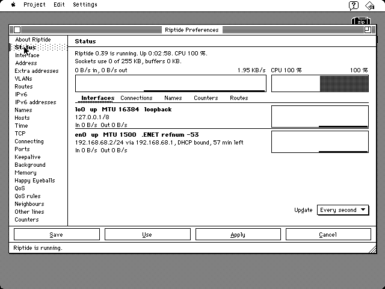
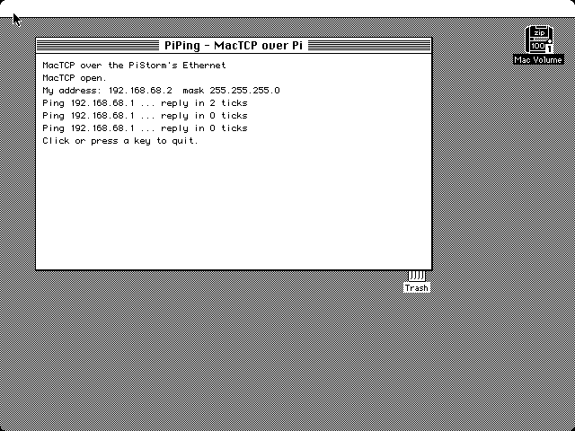
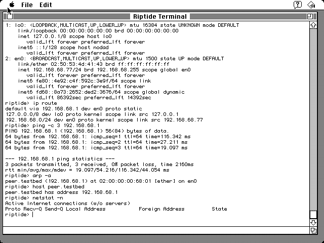
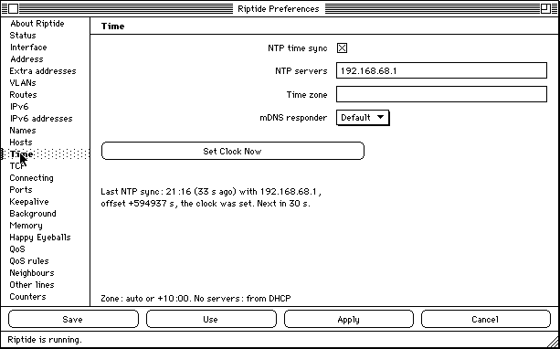

# Riptide on the classic Mac OS

Riptide as a MacTCP replacement: the `.IPP` driver that every classic Mac Internet program talks
to, with Riptide's core behind it and the Mac's own `.ENET` Ethernet driver underneath, exactly
where MacTCP sits. A program written for MacTCP opens `.IPP` and makes the same Control calls;
the Ethernet card's driver sees the same protocol handlers and EWrite calls MacTCP would make.
The target is System 7 (6.0.7 should work but is untested) on a 68020 or later, without Open
Transport, which installs a MacTCP layer of its own.

Developed and tested on Aurora68 (a Raspberry Pi in a Macintosh's 68000 socket running the
Macintosh IIci ROM; github.com/farsonic/Aurora68), whose testbed boots System 7.1 under QEMU with
an Ethernet card and a host-side peer, but nothing in `src/mac/` depends on it except the
optional development log.

## Status

| Stage | What | State |
|---|---|---|
| 1 | The driver installs and starts at boot, the core runs, Ethernet through `.ENET`, `ipctlGetAddr`, `ipctlEchoICMP` | done: PiPing (a MacTCP ping) gets replies through Riptide |
| 2 | TCP and UDP: TCPCreate ... TCPRelease, the UDP set, ASR notifications, TCPStatus, TCPGlobalInfo | done in the testbed (src/mac/mactcp.c); corrected 19 November 2026 for browsers: tests/mac/http_test.c ("TCP, UDP and the resolver") |
| 3 | The resolver: a `'dnrp'` code resource the DNR glue finds (StrToAddr, AddrToName; HInfo and MXInfo answer noAnsErr) | done in the testbed: the Riptide DNR file (src/mac/dnr), an asynchronous DNS client in the driver; since 19 November 2026 with the creator Apple's glue looks for |
| 4 | Preferences | done: RiptidePrefs, the Amiga's MUI editor built for the Mac (MAC-GUI.md) |
| 5 | The command-line tools | done: the Riptide Command Terminal, the Amiga's ip, ifconfig, route, arp, netstat, ping, ping6, traceroute, traceroute6, host, hostname, nc, ftp, sysctl and speedtest in a Mac window ("The Riptide Command Terminal" below) |
| 6 | `.IPP6`: a public IPv6 interface in MacTCP's style, for programs written for it | done in the testbed (21 November 2026): docs/IPP6.md, sdk/mac/IPP6.h, src/mac/ipp6.c ("The .IPP6 interface" below) |

Also working in the testbed (18 November): DHCP (`dhcp en0`: bound, lease kept), IPv6 (a
link-local address and one from the router advertisement's prefix, each passing duplicate
address detection and answering ICMPv6 echo; the IPv6 multicast groups are registered with
`.ENET`'s EAddMulti), riptide.conf from the Preferences folder with the Amiga's `interface`
line, and the Status page of RiptidePrefs reading the running stack.

On real hardware (19 November 2026), the user's Raspberry Pi 3B (the solo board, System 7.1, over
the WiFi):
- IPv6 confirmed: an IPv6 ping (ping6) through Riptide got its replies.
- Internet Explorer 4.01 for 68k works on Riptide's MacTCP interface: with the Riptide DNR found
  (below, "The resolver") it loads pages by name (google.com, frogfind.com) and by number
  (http://192.168.0.172:8080/, a Python http.server on another computer). Open Transport is not
  needed for it.





## How it fits together

```
 application (MacTCP API: PBControl on .IPP)          a program written for IPv6 (PBControl on .IPP6)
   |  drvr.S: Control entry; the call leaves the Device Manager's queue (a concurrent driver)
   v                                                        v
 ipp.c ------ queued, handled by the stack's deferred task ------ ipp6.c (docs/IPP6.md)
              completed with ioResult + ioCompletion
   |  Riptide's descriptor socket API (non-blocking)
   v
 src/core (unchanged: the same files as the Amiga build)
   |  rt_netif link_output / rt_netif_input
   v
 net_mac.c -- EWrite (async, transmit slots)  /  receive ring <- mac_enet_ph (drvr.S, EAttachPH)
   v
 .ENET (the card's driver: found with SGetTypeSRsrc, opened with OpenSlot)
```

**One context.** The Mac has one processor and no threads, so every call into the core happens
in the stack's deferred task (Deferred Task Manager: interrupt level 0 with interrupts enabled,
after the interrupt handlers). The Time Manager task (the core's next timer), the `.ENET`
protocol handler (a frame arrived) and the Control routine (a new call) only queue work and ask
for that task. The core's lock is therefore a nesting counter, and its wait queues never block:
the MacTCP interface is asynchronous anyway, and a synchronous caller spins on `ioResult` exactly
as it does with MacTCP. The task runs on the stack it interrupted. A private stack in the system
heap trips the stack sniffer (System Error 28, "stack collision with heap"), and the core keeps
its frames small (DESIGN.md).

**Memory.** The Memory Manager may not be called at interrupt time, so the OS layer allocates a
1 MB pool at Open and runs a first-fit allocator in it (`rt_malloc`). The Ethernet rings and the
driver itself are allocated at Open too. The extension's `'sysz'` resource asks System 7 to grow
the system heap for all of it before the INIT runs. Without it the 415 KB driver did not load.

**A concurrent driver.** MacTCP completes calls out of order: a TCPRcv can wait for minutes while
TCPSend calls complete. The Device Manager hands a driver one call at a time and starts the next
one at IODone. So the Control entry takes each call off the driver's queue, clears `drvrActive`
and returns (Inside Macintosh: Devices, "Writing a Device Driver"), and `mac_complete` later sets
`ioResult` and calls `ioCompletion` (A0 = the parameter block, D0 = the result). MacTCP's
notification routines are pascal procedures: `mac_call_pascal1` pushes the argument, also sets
A0 (PiPing's routine reads A0), and restores the stack pointer afterwards either way.

**A call made while the driver takes another** (23 November 2026). The Device Manager (the IIci
ROM's at 4080b5f6) puts every call on the driver's queue and, when `drvrActive` is clear, sets it
and calls the driver for the queue's head; while it is set a call is only queued, and IODone takes
the next one off the head. `drvrActive` is set with interrupts on, and the stack's deferred task
runs at the end of any interrupt that comes while a program is in `_Control` at level 0: a
completion routine it calls (a receive chained from its own completion, as Aurora68 Play's) can
make a call then, which is only queued. Until that day two things lost such a call: the Control
entry linked the call it was taking into the stack's list through its qLink, which was still the
Device Manager's link to the call behind, and the `_Dequeue` after it emptied the queue; and the
path for a call that waits never looked at the queue again, as IODone would. The call behind was
never completed: Aurora68 Play's synchronous TCPAbort waited for ever on the owner's SE (the Mac
frozen, the pointer moving), a video's receive stood still. Now `ipp_dm_dequeue` (ipp.c) takes a
call that waits off the queue, interrupts off, before its qLink is used, and drvr.S's path for it
looks at the queue with interrupts off and takes a call it finds as IODone would, the driver
staying active, through the entry its ioTrap names. The IPP6 test has the case ("a call queued
while the driver was busy"): with the fix 95 passed and 2 failed in Aurora68's testbed (a scope
name and riptide.conf host lines the run did not have), without it the call behind never completed.

**The image.** The driver is C compiled with an ordinary m68k ELF GCC (`-fno-pic`), linked at 0
with `--emit-relocs`. `tools/elf2mac.py` turns it into a `'DRVR'` resource: the code, the data,
the zero-filled BSS, then a table of every 32-bit absolute field. The driver's first Open adds
its load address to each field and flushes the instruction cache before any C runs (drvr.S). The
INIT (init.S, position independent) loads `'DRVR'` 128 into the system heap, installs it in a
free unit table entry, fills in the device control entry (`_DrvrInstall` makes the entry but
leaves the driver pointer and flags to the caller), and opens `.IPP`. If a `.IPP` driver is
already installed, MacTCP's for instance, it does nothing.

## Building and installing

```
make -f Makefile.mac                 # build/mac/Riptide.bin, a MacBinary extension file, and the
                                     # programs: RiptidePrefs.bin, RiptideTerminal.bin, RiptideDNR.bin
make -f Makefile.mac CONF=my.conf    # with my.conf as its riptide.conf ('TEXT' 128)
make -f Makefile.mac AURORA68=1      # development on Aurora68: the log also goes to the Pi's log
```

Needs `gcc-m68k-linux-gnu` and `binutils-m68k-linux-gnu` (Debian, Ubuntu) and Python 3. Copy
`Riptide.bin` into the System Folder's Extensions folder (`hcopy -m` for an HFS image, or any
MacBinary tool), take MacTCP out of the Control Panels folder, and restart.

The configuration is riptide.conf, the same generic keywords as on the Amiga (AMIGA.md,
"Configuration file"). Riptide reads the one RiptidePrefs saves (the Riptide folder in the
Preferences folder), else the Riptide file's `'TEXT'` 128 resource (make `CONF=`), else it opens
every Ethernet card with DHCP on each. The card line is the Amiga's, with the Mac's driver:
`interface en0 device=.ENET unit=0` (without any, every card is opened: en0, en1 ... in the Slot
Manager's order; "Several cards" below). A static setup:

```
ifconfig en0 192.168.1.20/24
route add default gw 192.168.1.1
nameserver 192.168.1.1
```

## Several cards

Every card the Slot Manager lists as catNetwork/typeEtherNet can be an interface of its own
(src/mac/net_mac.c, up to four): its own refnum from OpenSlot on its slot and sResource id, its
own protocol handlers (drvr.S has an entry point per card, `mac_enet_ph0` to `3`, because a
driver does not tell its handler which card it is), its own receive ring and transmit slots. One
NuBus card may hold several: Aurora68's slot-9 card carries its wired port (sResource $81,
`.Network_EtherNet_PiStorm`) and its WiFi ($83, `.Network_WiFi_PiStorm`), two drivers with two
unit-table entries. So a card is named by its slot and sResource id, by its kind, by part of its
driver's name, or by its place in the list:

```
interface en0 device=.ENET card=ethernet      # or slot=9 id=0x81, or unit=0
interface en1 device=.ENET card=wifi          # or slot=9 id=0x83, or unit=1, or card=Network_WiFi
dhcp en0
dhcp en1
```

`card=wifi` is a card whose driver's name has "WiFi", "Wireless" or "AirPort" in it;
`card=ethernet` any other. With `card=`, `slot=` or `id=`, a `unit=` on the same line (RiptidePrefs
always writes one) is ignored. A line that names a card the Mac does not have is logged and
skipped, so the same riptide.conf serves a Mac with only one of them. RiptidePrefs' first run
writes exactly the four lines above (with `unit=`).

**Which way out.** Each interface has a metric, 10 for a wired card and 20 for a WiFi card
(`metric=N` on the interface line changes it), and DHCP gives its routes that metric, so with both
cards on DHCP the default route goes through the wired card. The core keeps both default routes
even when both DHCP servers name the same router (src/core/route.c: the same route through
another interface is another route). A driver that can say whether its link is up is asked once a
second: Aurora68's answer csLinkStatus (230), a Control call of their own, with 'A68L' in the
answer so that it cannot be mistaken; other drivers are taken as always up. When the wired link
goes down the core stops using it (`rt_netif_link_change`) and the WiFi's route takes over; when
it comes back, DHCP confirms the lease and the wired route wins again. MacTCP's calls
(ipctlGetAddr, the MTU) report the interface the default route uses, which changes with it.

**mDNS** answers on every interface with that interface's addresses (src/core/mdns.c already
did); the host name is one, and the Mac's own answers heard back through the other card are
recognised as its own, so "macse.local" does not conflict with itself when both cards are on one
network.

**The Amiga build** shares only the two core changes (DHCP's routes take the interface's metric,
which is 0 there unless set; the same route through two interfaces is allowed); its own files are
unchanged.

**Tested** (19 November) on Aurora68's solo testbed, the wired card being the kernel's file bridge
or QEMU's USB network device, the WiFi a simulated radio, each with its own host peer: both cards
listed, opened with refnums -53 and -54 and their own addresses, DHCP bound on both (two networks),
pings out of each, two default routes with metrics 10 and 20; with the wired cable "pulled"
(`mac.netdown=`) a running ping moved to the WiFi within a second and back when the link returned,
one echo lost at the change (Aurora68's docs/08 item 49 and its docs/img/system71-riptide-*.png).
Once, after a 100-second outage, the Mac stopped with a system error just after the link came
back; a second run with a 40-second outage did not, and the cause is not known yet. Not tested:
a Mac with two real cards in two slots, and a driver without csLinkStatus (it is taken as always
up, so its route never yields).

**A waiting program is woken at once.** A program that waits in the core (the Terminal's ping in
recv, nc, ftp) sits in WaitNextEvent with a sleep of a tick; a reply used to set its sleeper's flag
and wait for that tick, 16.7 ms on top of every round trip. The waker now also calls WakeUpProcess
for the program's process (api_mac.c records it at attach; the call is allowed at interrupt time).
On Aurora68's testbed the Mac's side of a ping went from about 5 or about 16 ms (bimodal: the tick)
to 4 to 8 ms for most echoes under QEMU's slow emulated 68k (19 November).

## Testing on Aurora68

The Aurora68 repository's `tools/run-solo.sh` boots a System 7.1 disk image under QEMU with the
Pi kernel as the whole logic board, and `tools/pinet.py` is an Ethernet peer at 192.168.68.1 on
the host (ARP, ICMP echo, UDP and TCP echo, DHCP, DNS for `*.testbed`, HTTP on port 80). With
Riptide in the image's Extensions folder and MacTCP removed:

```
python3 tools/pinet.py /tmp/psmac-net peer &
HD=test.image tools/run-solo.sh 200 mac.net=/tmp/psmac-net
```

Built with `AURORA68=1`, every Riptide log line and the INIT's milestones show in the kernel log
as `[MAC] Riptide: ...`, written through the Aurora68 card's mailbox.

## TCP, UDP and the resolver (stages 2 and 3)

`src/mac/mactcp.c` makes each MacTCP stream a socket of the core. A call that cannot finish at
once (an open, a receive with no data, a send with the send buffer full) stays on its stream and
is looked at again whenever the stack runs; it completes like every other call, through
`ipp_result` (ioResult first, then ioCompletion with A0 = the parameter block and D0 = the result).
The notification routines (ASRs) are called from the stack's context, never from inside one
another, as the MacTCP Programmer's Guide describes the call: the pascal arguments on the stack
and A5 = the A5 of the program that created the stream (taken at its TCPCreate or UDPCreate),
D0 = the event, D1 = the reason, A1 = the ICMP report, A2 = the user data. TCPDataArrival when
data comes and no receive waits for it (once, until a receive completes), TCPClosing when the
other end has closed and all it sent has been delivered, TCPTerminate exactly once per connection
however it ends (TCPULPClose after both ends closed, TCPRemoteAbort, TCPULPAbort after TCPAbort,
TCPULPTimeoutTerminate), TCPULPTimeout for a stream that asked for "report" and whose sends have
not moved for the ULP timeout; UDPDataArrival. After TCPTerminate the stream is as TCPCreate left
it and may be opened again (browsers keep their streams). TCPNoCopyRcv and UDPRead hand out the
stream's own receive buffer (given back with TCPRcvBfrReturn and UDPBfrReturn); TCPSend completes
when its data is in the core's send buffer, TCPClose at once (MacTCP waits for the acknowledgement
of the FIN).

What is supported: ipctlGetAddr, ipctlEchoICMP, ipctlLAPStats; UDPCreate, UDPRead, UDPBfrReturn,
UDPWrite, UDPRelease, UDPMaxMTUSize; TCPCreate, TCPPassiveOpen (with the remote filter and the
command timeout), TCPActiveOpen (within the ULP timeout, 2 minutes by default), TCPSend (any WDS,
the push flag), TCPNoCopyRcv (any RDS of one entry or more), TCPRcvBfrReturn, TCPRcv (command
timeouts), TCPClose, TCPAbort, TCPStatus, TCPRelease, TCPGlobalInfo (with the stream table); the
validity bits, the guide's result codes, Gestalt `'mtcp'` (3, MacTCP 2.0). Not yet: urgent data
(sent as ordinary data, never reported), TCPExtendedStat, UDPStatus, UDPMultiCreate,
UDPMultiSend, UDPMultiRead, the ICMP reports of the notification routines, IP options, type of
service and time to live.

**Corrected on 19 November 2026**, when Internet Explorer 4.01 failed on the user's Mac with "A
read/write error has occurred (-28)": TCPStatus wrote its fields two bytes early (the guide's
TCPStatusPB has a long after the two ULP bytes, so remoteHost is at 38 and connectionState at 52;
a program reading the state saw nonsense); TCPNoCopyRcv refused an RDS of one entry, which the
guide calls "the simplest possible RDS"; the notification routines ran with whatever A5 was
current, so a program's globals were not its own there; a stream whose connection had ended could
not be opened again, and a graceful close never gave TCPTerminate; TCPActiveOpen took its timeout
from the passive open's command timeout byte; TCPGlobalInfo gave no stream table; zero-length
sends, receives into no buffer and returning a buffer twice gave no error.

**The resolver.** The Riptide DNR file holds `'dnrp'` 0 (src/mac/dnr): type `'cdev'`, creator
`'mtcp'`, in the System Folder. Apple's DNR glue, which every MacTCP program carries (dnr.c),
looks for the file holding `'dnrp'` in this order: the Control Panels folder for `'cdev'` `'ztcp'`,
the System Folder for `'cdev'` `'mtcp'`, the Control Panels folder for `'cdev'` `'mtcp'` (the oldest
glue, of 1988, only the System Folder for `'mtcp'`, taking the first such file). Until 19 November
2026 the file was made with creator `'ztcp'`, which no glue looks for in the System Folder: every
MacTCP program's OpenResolver failed, and StrToAddr answers notOpenErr (-28) when there is no
resolver, before it looks at the name, so even a dotted address failed, and the driver never heard
of it. That was Internet Explorer's -28.

The driver now checks these folders at startup, makes sure every version of the glue finds Riptide
DNR, and logs what it found and did:
- a Riptide DNR in the System Folder with the old creator is changed to `'mtcp'`;
- any other file the glue could take first is moved into a folder "Disabled (Riptide)" in the
  System Folder, which the glue does not search: the "MacTCP DNR" file MacTCP leaves in the System
  Folder when it has once run (`'cdev'` `'mtcp'`, a resource fork holding MacTCP's own `'dnrp'`),
  and a MacTCP control panel left in the Control Panels folder. "MacTCP DNR" comes before
  "Riptide DNR" in the folder's order, so every glue loads MacTCP's resolver from it; that asks
  `.IPP` for MacTCP's private settings (csCode 16), gets controlErr, and OpenResolver fails. That
  was the user's -28 together with the old creator, and why moving "MacTCP DNR" out of the System
  Folder by hand made Internet Explorer work. (The first version of this move, pushed in 3b80f79,
  logged the move without making it: the driver's File Manager glue did not pass
  `_HFSDispatch`'s selector; fixed the same day.)
To go back to MacTCP, put the files back from that folder.

A dotted address "is returned immediately" (the guide): noErr, rtnCode noErr, the address, the
other three zero, the dotted string as the name, the result procedure not called (Apple's own
sample, TCPDotAddress, polls rtnCode, which works either way). Names and addresses go to the
driver as a private call (`RTMAC_DNS`), and the answer reaches the program's result procedure from
the call's completion routine, StrToAddr having returned cacheFault meanwhile. AddrToName of an address the name servers do not know ends in authNameErr as soon as one
says so, in noAnsErr after about ten seconds if none answers (two servers, each tried twice);
HInfo, MXInfo and EnumCache answer noAnsErr. CloseResolver withdraws the lookups still waiting
(`RTMAC_DNSCANCEL`): Apple's glue disposes of the `'dnrp'` code straight afterwards, and their
completions must not run into it. The lookups are the driver's own small
DNS client (A and PTR queries over UDP, the configured name servers, the search domain), because
the core's resolver waits in select, which the deferred task must never do.

**The driver stays open.** Programs open `.IPP` by name; Close is refused with closErr, as MacTCP
refuses it, so a program that closes the driver on quitting leaves it open (dOpened set) for the
others and their reference numbers keep working.

**Programs that quit without releasing.** A MacTCP program that quits or crashes without
TCPRelease leaves streams whose receive buffer, notification routine and waiting calls lie in a
partition the Process Manager frees and hands to the next program; MacTCP lets data, completions
and notifications land there. Riptide asks for time (the driver's dNeedTime flag: the Device
Manager's SystemTask sends it accRun every sixth of a second, in a program's context, where the
Process Manager may be called), lists the partitions of the processes alive, and releases every
stream whose creator's A5 was in a partition that has gone, and drops the lookups and echoes whose
parameter blocks were there, without completing their calls (logged: `.IPP: TCP stream ... of a
program that quit without releasing it: released`). A completion or notification that falls due
between the program's death and that check can still run in the freed partition: in the testbed,
the Browser test's Quit Leaving Streams Open with three transfers running once stopped the Finder
with "bad F-Line instruction" that way (the check then ran every half second; twice afterwards the
streams were released cleanly). Programs must release their streams, as with MacTCP. Patching
`_ExitToShell` to release them at the quit itself was tried and left out (19 November 2026): a
patch made at startup is replaced by the Process Manager's own, one made at the first accRun is
not there for the other programs (System 7.1's Process Manager keeps the trap table per program),
and one made in every program stopped the Finder with "bad F-Line instruction".

**Completion and notification routines.** A completion routine is called with the parameter
block in A0 and the result in D0 (the Device Manager's convention) and also on the stack, because
MacTCP.h declares TCPIOCompletionProc and UDPIOCompletionProc as C functions of the block; the
stack comes back either way. A synchronous call made from inside a completion or notification
routine (which the stack's task is running) would wait for that task for ever if it were queued;
the ones MacTCP answers at once (ipctlGetAddr, TCPStatus, TCPGlobalInfo, UDPMaxMTUSize,
TCPRcvBfrReturn, UDPBfrReturn) are answered there and then. Calls made asynchronously from those
routines are queued as usual and taken in the same round of the stack.

**The log.** Built with `AURORA68=1`, the driver logs to PiLog's Mac tab what programs ask of it,
so that a photograph of PiLog shows what a failing program wanted: the first call of each kind
(`.IPP: first TCPCreate (30)`), every call that ends in an error, once per call and result, with
its stream (`.IPP: TCPRcv (37) on stream 0012ab34: error -23016`), every csCode that is not
supported, once (`.IPP csCode 41 (TCPExtendedStat) is not supported yet: controlErr`), each
program's Open of the driver and each refused Close, and at startup the resolver check
(`resolver: Riptide DNR in the System Folder ('mtcp')`, or what is wrong).

Install: Riptide in the Extensions folder, Riptide DNR in the System Folder, MacTCP out of the
Control Panels folder; RiptidePrefs anywhere. `make -f Makefile.mac test` builds two test
programs that run against Aurora68's `tools/pinet.py`: MacTCPTest.bin (TCP and UDP echo on port 7,
DNS for `*.testbed`) and BrowserTest.bin (below).

**IPv6 for MacTCP programs.** MacTCP's interface knows only IPv4 (a host is a 32-bit `ip_addr`
everywhere), so Riptide gives an IPv6 host a stand-in IPv4 address, as DNS64 and NAT64 do (RFC 6147,
RFC 6146), but inside the Mac and without translating packets (src/mac/standin.c). It is the
"Bump-in-the-Host" of RFC 6535 in its function-mapping form: the resolver extension and the address
mapper sit where MacTCP's StrToAddr and TCPActiveOpen arrive, so unmodified programs (Internet
Explorer, Fetch, Netscape 2 and 3) reach IPv6-only hosts by name. Seen working on real hardware on
19 November 2026: Internet Explorer 4.01 on System 7.1, on a Raspberry Pi 3B running Aurora68's solo
board, loaded http://ip6only.me/, a site with no IPv4 address, over the user's IPv6 Internet link,
and the page reported that it was reached over IPv6. How it works:
- a name with no IPv4 address but an IPv6 one (a DNS AAAA record, or a riptide.conf `host` line
  with an IPv6 address) is answered with a stand-in from 198.18.0.0/15, RFC 2544's benchmarking
  range, which never appears on the Internet (`mactcp standin A.B.C.D[/N]` picks another);
- a stream that opens a stand-in gets a core socket of family IPv6 to the real address; the program
  sees the stand-in as the remote address (its open, TCPStatus) and its own IPv4 address as the
  local one; a UDP stream sends to a stand-in through a second socket, IPv6, on the same port, and
  datagrams from IPv6 hosts come with their stand-in as the sender;
- AddrToName of a stand-in answers the name it was made for;
- `mactcp ipv6 prefer` makes names with both kinds of address answer with a stand-in too, so MacTCP
  programs use IPv6 where they can (off by default: `mactcp ipv6 on`).
The table has 64 stand-ins; one in use by a stream keeps its address, and an idle one goes to a new
address only when all are taken, the one used longest ago first. The driver's lookups now also look
in the hosts table and the core's cache first (rt_resolve_local46), so `host` lines, IPv4 or IPv6,
reach MacTCP programs. For example, in the Command Terminal `conf host macbook6
2001:db8:7501:0:e3:5d43:1982:7c14`, then `http://macbook6:8080/` in Internet Explorer. An IPv6
literal in a URL (`http://[2001:db8::1]/`) cannot work in Internet Explorer 4: it does not parse
them, and MacTCP has no way to carry one; names are the way in.

Programs written or changed today can name IPv6 addresses themselves through `.IPP6` ("The .IPP6
interface" below), which needs no stand-ins.

**Internet Explorer and Open Transport.** Internet Explorer 4.01, the last version for 68k Macs,
runs on MacTCP: Microsoft's requirements for Internet Explorer 4 for the Macintosh (Knowledge
Base 181767) are a 68030 or later and "MacTCP or Open Transport 1.1.1 or later" (archive listings
of 4.01 give MacTCP 2.0.6). It does not need Open Transport; 4.5 and later are PowerPC only. What
Open Transport support on Riptide would take is in docs/MAC-OT.md.

### The browser test

tests/mac/http_test.c ("Browser test", BrowserTest.bin) uses MacTCP the way a web browser of 1997
does, against pinet's HTTP server on port 80 (`/` a page, `/big` 256 KB in lines that can be
checked, `/slow` the page in pieces a second apart, `/reset` a reset after the headers). It is an
ordinary Mac application (Human Interface Guidelines, 1992): the tests run at launch and again with
File > Run Tests (Command-R); the event loop goes on while they run (every call is asynchronous,
its completion looked for between events), the results window scrolls and redraws; File > Stop
(Command-period), the close box, File > Close and File > Quit stop the tests with TCPAbort and
TCPRelease on every stream and CloseResolver, waiting for every call to come back, so nothing is
left with the driver that points into the program. File > Quit Leaving Streams Open (Command-K)
quits without releasing, on purpose, to see the driver clean up after it.

What it checks: Gestalt `'mtcp'`; with MacTCP's "MacTCP DNR" left in the System Folder, that it was
moved aside and what the 1988 glue would take (Riptide DNR); the resolver found exactly as the 1991
glue finds it; StrToAddr with a dotted address (noErr at once, no result procedure) and with names; AddrToName with a name, without
one (authNameErr within five seconds) and with a name server that never answers (noAnsErr, the
result procedure still called); AddrToStr, HInfo, MXInfo, EnumCache; `.IPP` opened by name, closed
(refused) and still open, the old reference number working; three streams at once, each call
asynchronous with a completion routine and each stream with a notification routine:
TCPActiveOpen, TCPSend with a WDS in three pieces, TCPNoCopyRcv with a six-entry RDS and
TCPRcvBfrReturn, TCPRcv into a locked handle, a TCPRcv that times out and then receives issued
again from inside the completion routine with no timeout, reading to connectionClosing, TCPStatus,
TCPClose and TCPTerminate (TCPULPClose); a fourth stream read by polling TCPStatus for
amtUnreadData and making a synchronous TCPStatus inside its notification routine; a stream opened
again; a reset (TCPRemoteAbort); TCPAbort; an open refused (openFailed); TCPGlobalInfo;
TCPRelease. The completion routines check that ioResult was set before they ran and that the block
is both in A0 and on the stack; the notification routines that A5 is the program's, D0 and A2 as
the guide says, and that they are never re-entered.


Results in the testbed (Aurora68's solo board under QEMU, System 7.1, `tools/pinet.py` as the
peer, 19 November 2026): the first run, 70 of 77, showed four things, all fixed the same day: the
startup move of "MacTCP DNR" did nothing (the driver's File Manager glue, above); pinet stalled the
256 KB file (it sent a whole window at once and never resent a frame the Mac's receive ring had no
room for; it now paces and goes back N); a reset could arrive before the receive was made (the
test accepts connectionDoesntExist too); and Quit Leaving Streams Open, with transfers running,
crashed the Finder with "bad F-Line instruction" (programs that quit, above). Then 83 of 83, with
IPv6: Stop (Command-period) in the middle of a run released everything; Run Tests again ran
cleanly; Quit Leaving Streams Open had its three streams released by the driver's check.

## The .IPP6 interface

MacTCP's interface knows only IPv4, and the stand-ins above are the way in for the programs of the
1990s, which cannot change. A program written or changed today can use `.IPP6`, the second driver
Riptide installs beside `.IPP`: MacTCP's model (PBControl with MacTCP's csCodes and parameter blocks,
synchronous or asynchronous with ioCompletion, notification routines, MacTCP's result codes, the same
interrupt-time rules) with a 20-byte `IP6Address` (16-byte address, port, scope) wherever MacTCP has
an `ip_addr` and a port. IPv4 hosts are IPv4-mapped addresses, so one stream type covers both
families; names are resolved by the driver itself (`ip6Resolve`: AAAA and A, RFC 6724's order, or
IPv6 or IPv4 first), with no `'dnrp'` resource. A program finds it with Gestalt `'ipp6'` (the
interface version, 1) or OpenDriver(".IPP6"), and falls back to `.IPP` when it is not there. The
first program written for it is Aurora68 Play, Aurora68's internet radio, which reads its stream
with TCPRcv calls chained from their completion routines into the audio ring.

- The specification, for anyone writing a program: **docs/IPP6.md** (every call, every field's
  offset, the address structure, detection and the MacTCP fallback, completion and notification
  rules, the result codes, versions, examples).
- The header for programs: `sdk/mac/IPP6.h` (standalone, C89, MPW C, THINK C, CodeWarrior 68k, GCC);
  an example: `sdk/mac/examples/ipp6get.c` (looks `.IPP6` up, resolves names, connects to the
  addresses in order, IPv6 first, falling back to IPv4, fetches a page; on a Mac without `.IPP6` it
  uses `.IPP`). `make -f Makefile.mac examples` builds it as `build/mac/ipp6get.bin`.
- The driver: drvr.S has a second driver header (`_drvr6_start`) and entry points, which share
  `.IPP`'s IODone and concurrent-driver code; `src/mac/ipp6.c` installs it with `_DrvrInstall` in a
  free unit table entry (48 and up, as the INIT's rule) when `.IPP` first opens, registers Gestalt
  `'ipp6'`, and keeps its own queue, streams and lookups, polled by ipp.c's `ipp_poll` in the same
  round of the stack's deferred task. `.IPP` is unchanged; the two share the stack, ipp.c's table of
  creators' A5 and its check for programs that quit.
- riptide.conf: `ipp6 order rfc6724|ipv6|ipv4`, the order of `ip6Resolve`'s answers when the program
  does not ask for one (RFC 6724 by default; its policy table puts IPv4 before a unique local IPv6
  address, fd00::/8, and a global IPv6 address before IPv4).
- tests/t_ipp6_layout.c checks every offset of the header against the specification (on the host
  with 68k sizes; `make -f Makefile.mac build/mac/t_ipp6_layout` builds it for the m68k and runs it
  under qemu-m68k).

### The .IPP6 test

tests/mac/ipp6_test.c ("IPP6 test", `make -f Makefile.mac test`: build/mac/IPP6Test.bin) runs at
launch against pinet (peer.testbed has an A and an AAAA record, v6only.testbed only AAAA, www.testbed
only A; HTTP and UDP echo over both families), every call asynchronous with a completion routine that
checks ioResult and the block in A0 and on the stack, every stream with a notification routine that
checks A5, D0, A2 and re-entry. The run's riptide.conf adds `host h6.lan fd68::80` and `host h6.lan
192.168.68.1`. What it does is listed at the top of the file.

Results in the testbed (Aurora68's solo board under QEMU, System 7.1, `tools/pinet.py` as the peer,
21 November 2026): `.IPP6 installed (unit 53, reference number -54)` at startup, then 95 of 95, the
example program in the same boot (Gestalt, ip6GetInfo, its addresses, then peer.testbed and
v6only.testbed fetched over IPv6 and www.testbed over IPv4). Among them: AAAA and A answered together,
each order (with fd68::/64, a unique local prefix, RFC 6724 puts IPv4 first, as its policy table
says), the hosts table's IPv6 and IPv4 lines, a server that never answers ending in noAnsErr after
the 3-second timeout, ip6ResolveCancel; TCP over IPv6 with both ends' addresses in TCPStatus, 256 KB
read by a TCPRcv chain issued from its own completion routine at interrupt time, TCPClosing on the
server's close and TCPTerminate (TCPULPClose) after TCPClose, TCPRemoteAbort on a reset; the fallback
from fd68::99, which nothing answers (ipDestDeadErr after about three seconds), to 192.168.68.1;
UDP echo over IPv6 and IPv4 on one stream with UDPDataArrival; 85 completion routines with ioResult
set first and the block in A0 and on the stack, the notification routines with the program's A5,
D0 and A2 and never re-entered. The first run, 92 of 95, found three things, fixed the same day:
ip6AddrToStr wrote an IPv4-mapped address as `::ffff:192.168.68.1` instead of dotted decimal; the
calls answered in the Control call, when made asynchronously, completed through the Device Manager's
IODone, whose completion routine gets the block in A0 but not on the stack (they are now queued when
asynchronous); and the test did not allow for a reset that arrives before the chained receive is
made (connectionDoesntExist, as the Browser test allows). The Browser test (`.IPP`, the stand-ins)
on the same Riptide: 83 of 83, as before. The example program on the same System 7.1 with Apple's
MacTCP instead of Riptide found no Gestalt `'ipp6'`, fell back to `.IPP` and fetched the page from
192.168.68.1 over MacTCP.

## The Riptide Command Terminal

Riptide for the Amiga comes with command-line tools (src/amiga/cmd). The Mac has no command line,
so the Riptide Command Terminal (src/mac/term, `build/mac/RiptideTerminal.bin`) is one: a window you can
move, resize and zoom, a scrolling console in Monaco 9, and a `riptide>` prompt. A line typed
there runs the tool it names, from the same source files as the Amiga's tools, unchanged
(compiled as RiptidePrefs' files are, with the Amiga's types and plain prototypes, docs/MAC-GUI.md):
`ip addr`, `ip route`, `ip neigh`, `ifconfig`, `route -n`, `arp -a`, `netstat -s`, `ping -c 3 HOST`,
`ping6`, `traceroute`, `host NAME`, `nc HOST PORT`, `ftp`, `sysctl -a`, `speedtest`. Output goes to
the console, Command-period stops the running tool (the Amiga's Ctrl-C), nc and ftp read lines
typed while they run (Command-D or Control-D ends that input, as Ctrl-\ does on the Amiga), Up
and Down bring back earlier lines, File > Clear Window (Command-K) empties it. Built in are
`help`, `history`, `clear`, `quit` and `conf LINE`, which hands a riptide.conf line to the
running stack (as the RIPTIDE port's COMMAND: `conf nameserver 192.168.1.1`,
`conf host printer 192.168.1.9`). The lines of the text file "Command Terminal Startup" in
Preferences:Riptide:, if there is one, run at launch as if typed ("Terminal Startup", the file's
name before the program was renamed on 19 November 2026, is read when there is no such file).

**The tools wait, and on the Mac nothing else does.** The tools use the BSD socket interface: a
recv waits for data, select for a socket or a timeout, a name lookup for its answer. MacTCP's
interface (ipp.c) never waits: it queues the call for the stack's deferred task. So the driver
has a second way in for programs: the private Control call `RTMAC_API` answers with the address
of a table of plain C functions (src/mac/api_mac.c, struct rtmac_api in
src/mac/prefs/mac_ipp_private.h): the core's socket calls (`rt_api_*`), the resolver
(`rt_resolve_name46`, `rt_resolve_addr`, `rt_resolve_addr6`), sysctl (the `net.riptide` tables
ip, route, arp and netstat print), the configuration commands, interface names. The program calls
them directly, in its own context, the way a bsdsocket.library call runs in the calling task on
the Amiga. While such a call runs the core is the program's: the deferred task, should an
interrupt start it, puts its work off, and the call asks for it again when it leaves
(os_mac.c, `mac_core_enter`/`mac_core_leave`). A call that must wait sleeps on its client's
sleeper: it gives the core back, calls the program's yield function (WaitNextEvent: the Mac, and
the deferred task that brings the frames in, go on; the window stays alive), takes the core again
and looks once more, until a waker sets the sleeper, the time is up or Command-period was
pressed (`-EINTR`, or `SIGBREAKF_CTRL_C` for a select that asked for it, as WaitSelect does).
src/mac/term/term_bsd.c turns the table into bsdsocket.library's and riptide.library's calls,
term_os.c gives the tools Output(), Input(), Delay(), the EClock (the Mac's Microseconds) and
the rest of what they use, on RiptidePrefs' exec and dos (mm_os.c).

On the Amiga each run of a tool is a fresh program. Here the tools stay loaded, so their static
data is put back before every run: the linker script (src/mac/term/term.ld) gathers their
`.data` and `.bss` in one place, and the terminal keeps a copy of the first.

Left out: `rtdiag`, which runs other commands through SystemTagList and writes a packet capture
(the Mac driver has no capture files). `speedtest` is in, but needs the Internet.



## The clock

Riptide can set the Mac's clock from time servers: the core's SNTP client (src/core/ntp.c, the
Amiga's; AMIGA.md "Time and .local names" has the protocol side), switched on in riptide.conf or
on RiptidePrefs' Time page ("NTP time sync", off by default):

```
ntp on                          # the DHCP lease's NTP servers (option 42), else pool.ntp.org
ntp pool.ntp.org 192.0.2.1      # or up to four names, IPv4 or IPv6 addresses
ntp interval 21600              # every 6 hours (default 3600 s; 64 to 604800)
ntp step 1000                   # set the clock only when it is this many ms off (Mac default 1000)
timezone +10:00                 # only to override the Map control panel (timezone auto: Map's)
```

The first sync is two seconds after the configuration is read (DHCP's lease brings its servers a
moment later, and a sync with them follows), then every interval; `ntp sync` (or **Set Clock
Now** on the Time page) syncs at once.

**Local time.** The Mac's clock counts local seconds since 1904. Riptide's wall clock is UTC: the
Mac's time less the time zone of the Map control panel, read from its MachineLocation in extended
parameter RAM (12 bytes at $E4, what `ReadLocation` reads: `gmtDelta`, seconds east of UTC in
24 bits, which includes daylight saving time when Map's box is ticked; the top bit of `dlsDelta`
says it is). It is read when Riptide starts and once a minute afterwards, so a change in Map, or
ticking daylight saving time, is followed. A Map that was never set (all zero) means local time is
taken as UTC; the log says so. `timezone +HH:MM` in riptide.conf overrides Map. The log shows
what is used: `time zone: UTC+11:00 with daylight saving time (the Map control panel)`.

**Fractions of a second.** The Time global moves on once a second. The stack's task looks at it
at least every 100 ms and notes when it moves on by one; the time since then is the fraction of
the second (to within half the gap between two looks), so NTP's offsets are measured to about
0.05 s rather than to a second.

**Setting it.** `SetDateTime` writes the clock chip, which is not done at interrupt or deferred
task time. The NTP client (in the stack's deferred task) only notes the time it wants; the
driver's accRun (dNeedTime: the Device Manager sends it every sixth of a second from SystemTask, in
a program's context) calls `SetDateTime`, just after the chip's next tick, so the new seconds start
where the chip's seconds start, rounded to the nearest second. It is logged from the stack's task:

```
ntp: 192.168.68.1 stratum 2, offset +594452.920 s, clock set
ntp: the Mac's clock set to 2026-11-23 21:08:17 local time (+594453 s)
ntp: 192.168.68.1 stratum 2, offset -0.042 s
```

The Mac's clock is set in whole seconds, so the client steps it only when it is at least
`ntp step` (1000 ms on the Mac) off; smaller offsets are measured and shown, not corrected (the
Mac cannot slew its clock either).

**RiptidePrefs.** The Time page: "NTP time sync", "NTP servers" (empty: the DHCP lease's, else
pool.ntp.org; host names or addresses separated by spaces, at most four), "Time zone" (auto: the
Map control panel), then **Set Clock Now** and a line about the last sync ("Last NTP sync: 21:08
(5 min ago) with 192.168.68.1, offset -0.042 s, the clock was left as it was. Next in 55 min.").
Set Clock Now gives the running Riptide the page's servers when they differ from what it has
(saved or not), asks for a sync, waits up to 12 s and shows the answer; the clock itself is set at
the next accRun, a sixth of a second later. The Status page's Names tab shows the same.

**Tested** (23 November 2026) on Aurora68's solo testbed (System 7.1, the IIci ROM, the kernel's
emulated clock chip), with Map's location preset to UTC+11:00 with daylight saving time
(`mac.xpram=e4:000000000000000080009ab0`) and a small SNTP server on the host reached through
pinet's UDP relay (`PINET_UDP="123=127.0.0.1:18123"`): the clock went from a week behind to the
host's UTC + 11 h at the first sync (the kernel's clock chip held the new seconds), and the syncs
every 64 s after it measured -0.04 to -0.10 s, without stepping again. With the host's server then
made an hour fast, Set Clock Now in RiptidePrefs (opened and clicked through the testbed's remote
control) found +3601.3 s, set the clock to 22:17:08 and showed the result; the next syncs measured
+0.28 and +0.34 s and left it. Not tested: a real SE's clock chip, and System 6.



## Notes for the next stages

- Real programs (Internet Explorer 4.01, Fetch, NCSA Telnet) on real hardware will show what is
  still missing; the candidates are urgent data, TCPExtendedStat, UDPStatus, UDPMulti*, ICMP
  reports, HInfo and MXInfo. The log names each unsupported csCode and each error once.
- Open Transport: docs/MAC-OT.md.
